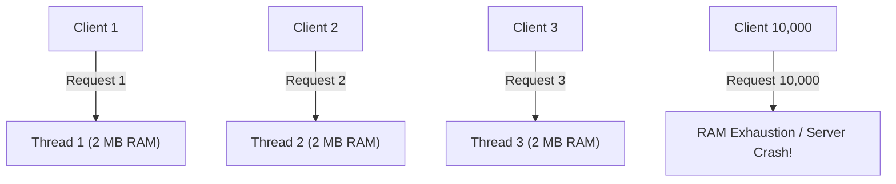
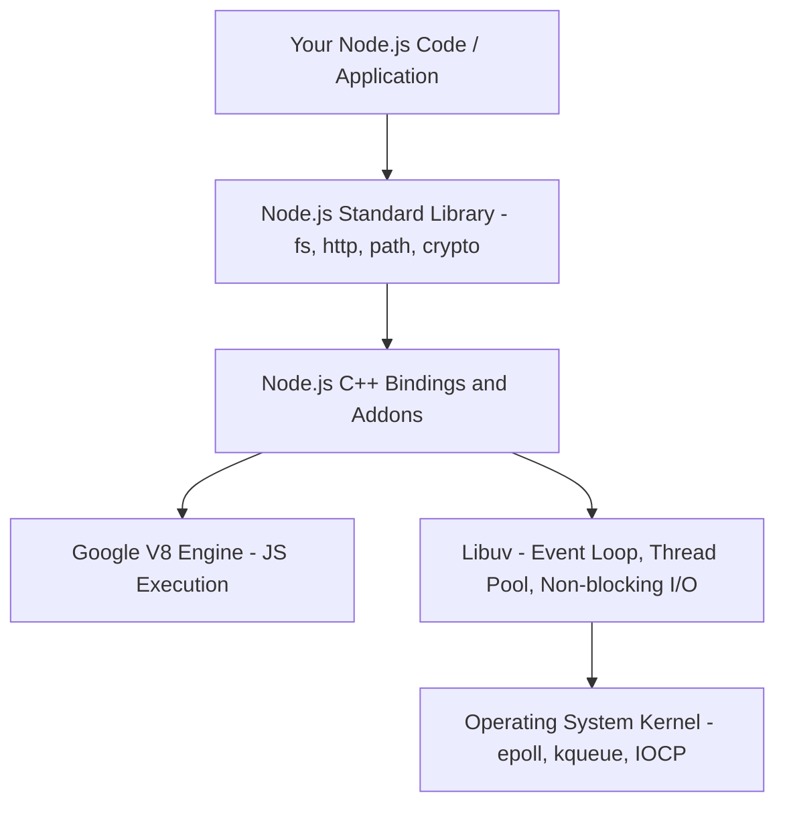

# ১. Tracing Where Everything Began (যেখান থেকে Node.js-এর সূচনা)

Node.js-এর জন্ম কীভাবে এবং কেন হয়েছিল—এটি যেকোনো সিনিয়র বা ব্যাকএন্ড ডেভেলপার ইন্টারভিউতে একটি বহুল জিজ্ঞাসিত প্রশ্ন। এই অধ্যায়ে আমরা জানব Node.js তৈরির পেছনের প্রেক্ষাপট, রায়ান ডাল (Ryan Dahl)-এর অনুপ্রেরণা এবং সার্ভার আর্কিটেকচারের ঐতিহাসিক রূপান্তর।

---

## ১. ঐতিহাসিক প্রেক্ষাপট: ২০০৯ সালের আগের সার্ভার জগত

২০০৯ সালের আগে ওয়েব অ্যাপ্লিকেশন ও সার্ভার সাইড ডেভেলপমেন্টের প্রধান চালিকাশক্তি ছিল:
- **Apache HTTP Server** (C/C++ ভিত্তিক)
- **Java Servlets (Tomcat)**
- **PHP**
- **Ruby on Rails / Python Django**

এই সার্ভারগুলো কাজ করত **"Multi-threaded / Process-per-request"** আর্কিটেকচারে।



### সমস্যা কী ছিল?
1. **Thread-per-request মডেল:** প্রতিটি নতুন রিকোয়েস্টের জন্য সার্ভার একটি করে ডেডিকেটেড থ্রেড বরাদ্দ করত। প্রতিটি থ্রেডের নিজস্ব স্ট্যাক মেমোরি থাকত (সাধারণত ১ থেকে ২ মেগাবাইট)।
2. **The C10K Problem (১০,০০০ কনকারেন্ট ক্লায়েন্ট সমস্যা):** ১৯৯৯ সালে ড্যান কেগেল (Dan Kegel) প্রথম "C10K Problem" টার্মটি উল্লেখ করেন—কীভাবে একটি সিঙ্গেল সার্ভার একসাথে ১০,০০০ কনকারেন্ট কানেকশন সামলাতে পারে?
   - যদি ১০,০০০ ক্লায়েন্ট একই সময়ে কানেক্টেড থাকে, তবে শুধু থ্রেড স্ট্যাক মেমোরির জন্যই প্রয়োজন হতো:
     `10,000 × 2 MB ≈ 20 GB RAM`
   - সে সময়ে সার্ভারে ২০ জিবি র‍্যাম থাকা ছিল অত্যন্ত ব্যয়বহুল ও অস্বাভাবিক।
3. **I/O Blocking ও Resource Wasting:** 
   ধরা যাক, ক্লায়েন্ট একটি ফাইল আপলোড করছে বা ডাটাবেস থেকে কিছু কুয়েরি করছে। যতক্ষণ ডাটাবেস রেসপন্স না করত, ততক্ষণ সংশ্লিষ্ট থ্রেডটি ব্লক হয়ে অলস (idle) বসে থাকত। ফলে থ্রেড কোনো কাজ না করেও মেমোরি এবং সিপিইউ রিসোর্স আটকে রাখত।
4. **Context Switching Overhead:** অপারেটিং সিস্টেমকে হাজার হাজার থ্রেডের মাঝে দ্রুত সুইচ করতে হতো (Context Switching), যা সিপিইউর সাইকেল মারাত্মকভাবে অপচয় করত।

---

## ২. রায়ান ডাল (Ryan Dahl)-এর অনুপ্রেরণা ও Flickr আপলোড সমস্যা

২০০৯ সালে একজন তরুণ সফটওয়্যার ইঞ্জিনিয়ার **রায়ান ডাল (Ryan Dahl)** একটি সাধারণ সমস্যা সমাধান করতে গিয়ে হতাশ হন:

> **ফ্লিকার (Flickr) ফাইল আপলোড বার সমস্যা:**
> রায়ান লক্ষ্য করেন, ফ্লিকারে ছবি আপলোড করার সময় প্রগ্রেস বার (Progress bar) দেখানোর জন্য ব্রাউজারকে বারবার সার্ভারে রিকোয়েস্ট পাঠাতে হতো। কিন্তু সার্ভার সেই সময়ে পুরো ফাইল আপলোড না হওয়া পর্যন্ত ফাইল সাইজ বা স্ট্যাটাস জানাতে পারত না, কারণ সার্ভার রিকোয়েস্টের I/O অপারেশনে ব্লক হয়ে বসে থাকত।

রায়ান উপলব্ধি করলেন:
- সার্ভার সাইডের মূল সমস্যা কোড বা ভাষার নয়, সমস্যা হচ্ছে **I/O (Input/Output) হ্যান্ডলিংয়ের ধারণায়**।
- ওয়েব সার্ভারের বেশিরভাগ সময়ই কাটে I/O-এর অপেক্ষায় (ডাটাবেস কুয়েরি, ফাইল রিড/রাইট, নেটওয়ার্ক রিকোয়েস্ট)। একে বলা হয় **I/O-Bound Task**।
- যদি কোড সিকুয়েনশিয়ালভাবে অপেক্ষা (blocking wait) না করে নন-ব্লকিং (Non-blocking Asynchronous) পদ্ধতিতে ইভেন্ট আকারে কাজ করে, তবে একটি সিঙ্গেল থ্রেড দিয়েই লাখ লাখ রিকোয়েস্ট পরিচালনা করা সম্ভব!

---

## ৩. গুরুত্বপূর্ণ ভিত্তি: ২০০৮ সালে Google V8 ইঞ্জিনের আগমন

২০০৮ সালে গুগল তাদের **Google Chrome** ব্রাউজারের সাথে উন্মুক্ত করে ওপেন-সোর্স **V8 JavaScript Engine** (যা C++ এ লেখা)।

V8 ইঞ্জিনের উদ্ভাবনী ক্ষমতা ছিল বৈপ্লবিক:
- এটি জাভাস্ক্রিপ্ট কোডকে সরাসরি মেশিন কোডে (Just-In-Time - JIT Compilation) রূপান্তর করত, কোনো ইন্টারপ্রেটার ছাড়াই।
- এর গতি সি++ বা জাভার কাছাকাছি পৌঁছে যায়।

রায়ান ডাল বুঝলেন:
1. জাভাস্ক্রিপ্ট ভাষায় কোনো নেটিভ I/O বা থ্রেডিং লাইব্রেরি ছিল না (ব্রাউজারে JS ছিল ইভেন্ট-লুপ ও কলব্যাক নির্ভর)।
2. জাভাস্ক্রিপ্ট ডেভেলপাররা আগে থেকেই ব্রাউজারে `onClick`, `setTimeout` এবং AJAX কলব্যাকের সাথে অভ্যস্ত ছিল।
3. V8 ইঞ্জিনের অতি দ্রুতগতির সাথে যদি C/C++ এর লো-লেভেল নন-ব্লকিং I/O লাইব্রেরি জুড়ে দেওয়া যায়, তবে বিশ্বমানের সার্ভার তৈরি করা সম্ভব।

---

## ৪. ২০০৯: Node.js-এর আত্মপ্রকাশ

২০০৯ সালের মে মাসে ইউরোপীয় JSConf কনফারেন্সে রায়ান ডাল প্রথমবারের মতো **Node.js** প্রজেক্ট উপস্থাপন করেন। সেখানে তিনি লাইভ দেখান কীভাবে একটি সিঙ্গেল থ্রেডে নন-ব্লকিং ইভেন্ট লুপের সাহায্যে হাজার হাজার কানেকশন কোনো মেমোরি লিক ছাড়া অত্যন্ত দ্রুত গতিতে হ্যান্ডেল করা যায়। সেই প্রেজেন্টেশনের পর তিনি স্ট্যান্ডিং ওভেশন পেয়েছিলেন।

Node.js-এর মূল রেসিপি ছিল:

```text
Node.js = Google V8 Engine + Libuv (Event Loop & Thread Pool) + C++ Core Bindings + JS Standard Library
```



---

## ৫. ইন্টারভিউ প্রশ্নোত্তর (Interview Q&A)

### প্রশ্ন ১: Node.js তৈরির পেছনের মূল উদ্দেশ্য কী ছিল?
**উত্তর:** Node.js তৈরির মূল উদ্দেশ্য ছিল ট্র্যাডিশনাল মাল্টি-থ্রেডেড সার্ভারগুলোর I/O ব্লকিং সমস্যা এবং C10K (একসাথে ১০,০০০ কানেকশন হ্যান্ডেল করার) সীমাবদ্ধতা সমাধান করা। নন-ব্লকিং অ্যাসিঙ্ক্রোনাস আর্কিটেকচার এবং ইভেন্ট লুপ ব্যবহারের মাধ্যমে কম রিসোর্সে বিপুল সংখ্যক কনকারেন্ট কানেকশন পরিচালনা করাই ছিল এর উদ্দেশ্য।

### প্রশ্ন ২: রায়ান ডাল কেন জাভাস্ক্রিপ্ট বেছে নিয়েছিলেন? সি++ বা পাইথন কেন নয়?
**উত্তর:**
1. **কোনো লেগাসি ব্লকিং I/O ছিল না:** পাইথনে `file.read()` বা সি-তে `read()` কল করলে থ্রেড ব্লক হয়ে যায়। কিন্তু জাভাস্ক্রিপ্টে ব্রাউজারের ইতিহাস থেকেই কোনো ব্লকিং I/O মেথড ছিল না। ফলে নন-ব্লকিং এপিআই তৈরি করা সহজ ছিল।
2. **ইভেন্ট ড্রাইভেন ও ফার্স্ট-ক্লাস ফাংশন:** জাভাস্ক্রিপ্টে ফাংশন হলো First-Class Citizen এবং কলব্যাক ও ইভেন্ট হ্যান্ডলিং ভাষার একদম কোর মেকানিজম।
3. **Google V8-এর অতি দ্রুতগতি:** ২০০৮ সালে প্রকাশিত V8 ইঞ্জিনের JIT কম্পাইলেশন পারফরম্যান্স জাভাস্ক্রিপ্টকে সি++ এর কাছাকাছি গতি প্রদান করেছিল।

### প্রশ্ন ৩: Libuv কী এবং Node.js-এ এর ভূমিকা কী?
**উত্তর:** Libuv হলো সি (C) ভাষায় লেখা একটি মাল্টি-প্ল্যাটফর্ম সাপোর্ট লাইব্রেরি, যা প্রাথমিকভাবে Node.js-এর জন্যই তৈরি হয়েছিল। এটি অপারেটিং সিস্টেমের কার্নেল মেকানিজম (লিনাক্সে `epoll`, ম্যাকওএসে `kqueue`, উইন্ডোজে `IOCP`) ব্যবহার করে অ্যাসিঙ্ক্রোনাস নন-ব্লকিং I/O এবং ইভেন্ট লুপ নিশ্চিত করে। এছাড়া ফাইল সিস্টেম বা ডিএনএস লুকআপের মতো ব্লকিং অপারেশনের জন্য Libuv নিজস্ব ব্যাকগ্রাউন্ড থ্রেড পুল (ডিফল্ট ৪টি থ্রেড) ব্যবহার করে।
