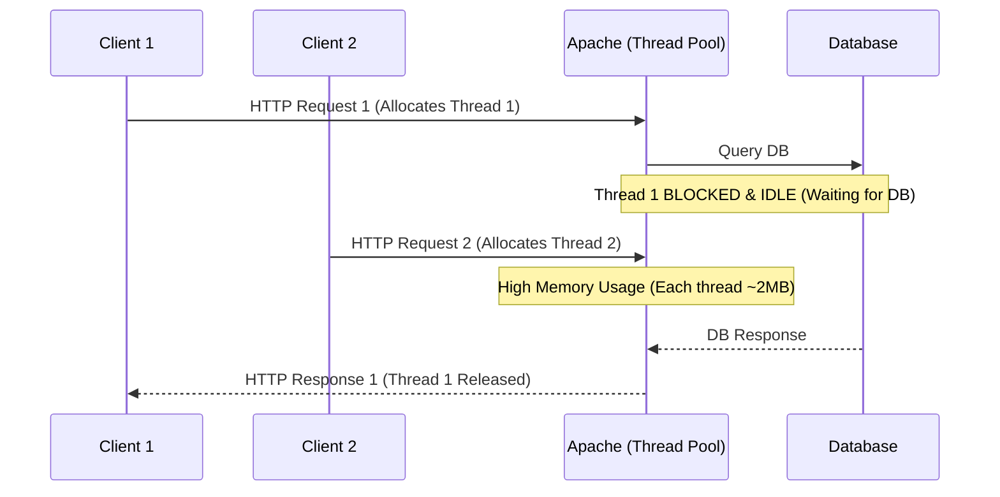
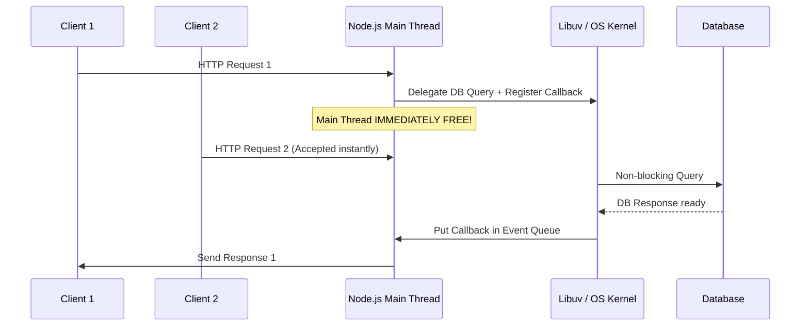

# ২. How Node.js Revolutionized the Server Landscape (সার্ভার জগতে Node.js-এর বিপ্লব)

Node.js আসার আগে এবং পরে ব্যাকএন্ড ইঞ্জিনিয়ারিংয়ের দুনিয়ায় আমূল পরিবর্তন এসেছে। এই আর্টিকেলে আমরা গভীরভাবে বুঝব কীভাবে Node.js ঐতিহ্যবাহী মাল্টি-থ্রেডেড সার্ভার মডেলকে ভেঙে চুরমার করে এক নতুন যুগের সূচনা করেছিল।

---

## ১. ঐতিহ্যবাহী সার্ভার বনাম Node.js (Apache vs Node.js)

পূর্বে সবচেয়ে জনপ্রিয় ছিল Apache HTTP Server। Apache এবং Node.js-এর কাজের পদ্ধতির তুলনা নিচের চিত্রে তুলে ধরা হলো:

### Apache Architecture (Thread / Process Per Request)

### Node.js Architecture (Single Threaded Non-blocking Event-Driven)

---

## ২. মূল বিপ্লবের ক্ষেত্রসমূহ

### ১) Blocking I/O বনাম Non-blocking Asynchronous I/O
- **ব্লকিং I/O (সরাসরি কোড এক্সিকিউশন আটকে থাকা):**
  অন্যান্য ব্যাকএন্ডে ফাইল পড়তে বা ডাটাবেস রিকোয়েস্ট পাঠালে কার্নেল যতক্ষণ ডাটা না ফিরিয়ে দিত, পুরো থ্রেডটি ফ্রিজ হয়ে থাকত।
- **নন-ব্লকিং I/O (Node.js পদ্ধতি):**
  Node.js রিকোয়েস্ট পাওয়ার সাথে সাথে কার্নেলকে (বা Libuv থ্রেড পুলকে) কাজ বুঝিয়ে দেয় এবং সাথে একটি কলব্যাক ফাংশন রেজিস্টার করে। মেইন থ্রেড কোনো অপেক্ষা না করে সাথে সাথে পরবর্তী রিকোয়েস্ট প্রসেস করতে শুরু করে। যখন কার্নেল থেকে ডাটা চলে আসে, ইভেন্ট লুপ সেই কলব্যাকটি এক্সিকিউট করে রেসপন্স পাঠিয়ে দেয়।

### ২) The C10K Problem সমাধান
Apache বা পুরনো সার্ভার যেখানে ১০,০০০ সমসাময়িক ক্লায়েন্ট আসলেই মেমোরি সংকট (Out Of Memory) বা থ্রেড স্টারভেশনে ক্র্যাশ করত, Node.js সেখানে মাত্র কয়েক মেগাবাইট মেমোরি খরচ করে সহজে হাজার হাজার সমসাময়িক সংযোগ বজায় রাখতে সক্ষম হয়।

### ৩) ফুলস্ট্যাক জাভাস্ক্রিপ্ট (One Language to Rule Frontend & Backend)
Node.js আসার আগে:
- ব্রাউজারের ফ্রন্টএন্ড ছিল JavaScript।
- ব্যাকএন্ড ছিল Java, PHP, C# বা Python।
- দুই প্রান্তের জন্য ডেভেলপারদের ভিন্ন ভিন্ন সিনট্যাক্স, প্যারাডাইম এবং ডাটা ভ্যালিডেশন লজিক ডুপ্লিকেট লিখতে হতো।

Node.js আসার পর:
- একই ডেভেলপার ফ্রন্টএন্ড এবং ব্যাকএন্ড উভয়েই কাজ করতে পারে (Full-stack JavaScript Developer)।
- ডাটা মডেল, টাইপস্ক্রিপ্ট ইন্টারফেস, ইউটিলিটি ফাংশন সরাসরি ক্লায়েন্ট ও সার্ভারে শেয়ার করা সম্ভব হয়।
- ডেটা আদান-প্রদানে JSON (JavaScript Object Notation) নেটিভ ফরম্যাট হওয়ায় কোনো অতিরিক্ত পার্সিং ওভারহেড থাকে না।

### ৪) NPM (Node Package Manager)-এর বিস্ময়কর প্রসার
Node.js-এর সাথে চালু হওয়া **npm** বর্তমান পৃথিবীর সবচেয়ে বড় ওপেন সোর্স প্যাকেজ রেজিস্ট্রি (৩০ লক্ষেরও বেশি প্যাকেজ)। যেকোনো সাধারণ অ্যালগরিদম থেকে শুরু করে জটিল ক্লাউড ইন্টিগ্রেশন পর্যন্ত প্রস্তুত মডিউল পাওয়া যায়, যা সফটওয়্যার ডেভেলপমেন্ট সাইকেলকে বহু গুণ দ্রুত করে দিয়েছে।

### ৫) রিয়েলটাইম অ্যাপ্লিকেশন ও স্ট্রিমিং বিপ্লব
Node.js-এর ইভেন্ট-চালিত প্রকৃতি রিয়েল-টাইম অ্যাপের জন্য ছিল এক পরম আশীর্বাদ:
- **WebSockets / Socket.io:** চ্যাট অ্যাপ্লিকেশন, লাইভ নোটিফিকেশন, কোলাবোরেটিভ টুলস (Google Docs, Figma-র মতো ব্যাকএন্ড)।
- **Media Streaming:** নেটফ্লিক্স (Netflix) তাদের স্টার্টআপ টাইম ৭০% কমিয়ে আনে Node.js আর্কিটেকচারে স্থানান্তরিত হওয়ার পর।

---

## ৩. কোম্পানিগুলোর রূপান্তর কেস স্টাডি (Real-World Case Studies)

| কোম্পানি | পূর্ববর্তী টেকনোলজি | Node.js-এ আসার পর ফলাফল |
| :--- | :--- | :--- |
| **Netflix** | Java ভিত্তিক মনোলিথ | স্টার্টআপ টাইম ৪০ মিনিট থেকে কমে মাত্র ১ মিনিটে নেমে আসে, মেমোরি খরচ বহুগুণ কমে। |
| **PayPal** | Java + JavaScript | Node.js অ্যাপ তৈরি করতে ৩৩% কম লাইন কোড লেগেছিল এবং পারফরম্যান্স দ্বিগুণ হয়েছিল (দ্বিগুণ রিকোয়েস্ট পার সেকেন্ড)। |
| **LinkedIn** | Ruby on Rails | সার্ভার সংখ্যা ১৫টি থেকে কমিয়ে মাত্র ৪টিতে নামিয়ে আনা সম্ভব হয় এবং পারফরম্যান্স ২০ গুণ পর্যন্ত বৃদ্ধি পায়। |
| **Uber** | Python / বিভিন্ন টেকনোলজি | রিয়েলটাইম ড্রাইভার ও রাইডার ট্র্যাকিংয়ের মূল ইঞ্জিন তৈরি করা হয় Node.js দিয়ে। |

---

## ৪. ইন্টারভিউ প্রশ্নোত্তর (Interview Q&A)

### প্রশ্ন ১: Node.js কীভাবে একক থ্রেড (Single Thread) হওয়া সত্ত্বেও মাল্টি-থ্রেডেড সার্ভারের চেয়ে বেশি কনকারেন্সি দিতে পারে?
**উত্তর:** ঐতিহ্যবাহী সার্ভারগুলো সমসাময়িকতার (Concurrency) জন্য **অপারেটিং সিস্টেম থ্রেড** ব্যবহার করে (Thread-per-request)। কিন্তু থ্রেড তৈরি করা এবং মেমোরি বরাদ্দ করা ব্যয়বহুল।
Node.js কনকারেন্সি অর্জন করে **অ্যাসিঙ্ক্রোনাস নন-ব্লকিং I/O এবং ইভেন্ট লুপ**-এর মাধ্যমে। যেহেতু সার্ভারের ৯৫% রিকোয়েস্টই I/O-Bound (ডাটাবেস বা নেটওয়ার্কের জন্য অপেক্ষা), তাই মেইন থ্রেড কখনোই অপেক্ষায় বসে থাকে না। রিকোয়েস্টগুলোকে অফলোড করে দিয়ে এটি সেকেন্ডে লাখ লাখ নতুন কানেকশন গ্রহণ করতে পারে।

### প্রশ্ন ২: Node.js কোন ধরণের অ্যাপ্লিকেশনের জন্য অনুপযুক্ত এবং কেন?
**উত্তর:** **CPU-Bound বা ভারী কম্পিউটেশনাল অ্যাপ্লিকেশনের জন্য Node.js ডিফল্টভাবে অনুপযুক্ত।**
যেমন:
- ইমেজ বা ভিডিও প্রসেসিং
- জটিল গাণিতিক হিসাব বা ক্রিপ্টোগ্রাফি
- মেশিন লার্নিং মডেল ট্রেইনিং

**কারণ:** Node.js-এর জাভাস্ক্রিপ্ট কোড চলে একটি মাত্র মেইন থ্রেডে। যদি মেইন থ্রেডে একটি ভারী `for` লুপ বা সিপিইউ ইনটেনসিভ কাজ চলে, তবে পুরো ইভেন্ট লুপ ব্লক হয়ে যাবে এবং বাকি সব ক্লায়েন্টের রিকোয়েস্ট আটকে থাকবে।
*(তবে আধুনিক Node.js-এ এই সমস্যার সমাধানের জন্য `worker_threads` মডিউল ব্যবহার করা যায়।)*

### প্রশ্ন ৩: "I/O-Bound" বনাম "CPU-Bound" কাজের পার্থক্য কী?
**উত্তর:**
- **I/O-Bound:** যে কাজের বেশিরভাগ সময় ডাটা আদান-প্রদানের (ডিস্ক, ডাটাবেস, নেটওয়ার্ক) অপেক্ষায় কাটে। সিপিইউ এখানে খুব কম কাজ করে। উদাহরণ: API সার্ভার, CRUD অপারেশন, ফাইল আপলোড। (Node.js এর জন্য আদর্শ)।
- **CPU-Bound:** যে কাজে প্রসেসরকে একটানা হিসাব-নিকাশ করতে হয়। উদাহরণ: ভিডিও এনকোডিং, বিগ ডাটা পার্সিং, কৃত্রিম বুদ্ধিমত্তা।
