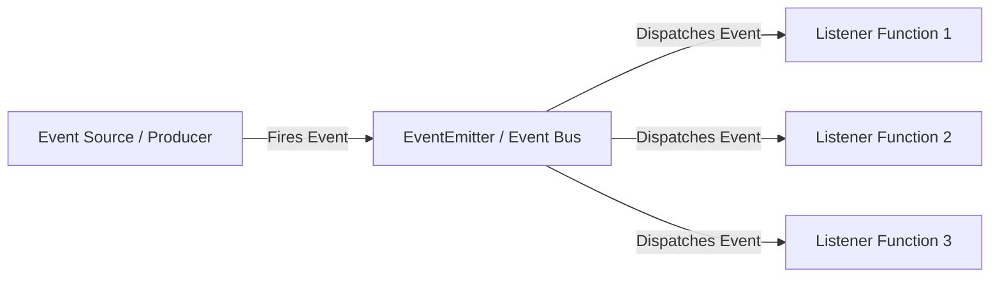

# ৩. Event Driven Architecture of Node.js (ইভেন্ট ড্রাইভেন আর্কিটেকচার)

Node.js-এর হৃদপিণ্ড হলো এর **Event-Driven Architecture** (ইভেন্ট-চালিত স্থাপত্য)। ইন্টারভিউতে প্রায়ই জানতে চাওয়া হয়: "Node.js ইভেন্ট-চালিত বলতে কী বোঝায়?", "`EventEmitter` কীভাবে কাজ করে?" এবং "ইভেন্ট লিসেনারের কারণে কীভাবে মেমোরি লিক হতে পারে?"। এই অধ্যায়ে বিস্তারিত সবকিছু ব্যাখ্যা করা হলো।

---

## ১. Event-Driven Architecture (EDA) কী?

Event-Driven Architecture হলো এমন একটি সফটওয়্যার ডিজাইন প্যারাডাইম, যেখানে সফটওয়্যারের কার্যক্রম নির্ধারিত হয় কোনো **ইভেন্ট (Event)** বা ঘটনার প্রেক্ষিতে।

- **ইভেন্ট কী?** সিস্টেমে ঘটে যাওয়া যেকোনো পরিবর্তন বা ঘটনা। যেমন:
  - কোনো ইউজার একটি HTTP রিকোয়েস্ট পাঠিয়েছে (`request` event)।
  - ফাইল থেকে ডাটার একটি অংশ পড়া শেষ হয়েছে (`data` event)।
  - ডাটাবেস বা নেটওয়ার্ক সকেট বন্ধ হয়ে গেছে (`close` event)।
  - কোনো ত্রুটি ঘটেছে (`error` event)।



### Observer Design Pattern
Node.js-এর ইভেন্ট আর্কিটেকচার মূলত গ্যাং অফ ফোরের বিখ্যাত **Observer Pattern** অনুসরণ করে:
1. **Subject (EventEmitter):** যে ঘটনা ঘটার নোটিফিকেশন তৈরি করে।
2. **Observers (Listeners):** যারা ওই ঘটনার অপেক্ষায় থাকে এবং ঘটনা ঘটলে নির্দিষ্ট ফাংশনটি স্বয়ংক্রিয়ভাবে কল হয়।

---

## ২. Node.js `EventEmitter` ক্লাস

Node.js-এর কোর মডিউল `events`-এ রয়েছে `EventEmitter` ক্লাস। প্রায় সব বড় কোর মডিউল (যেমন `http`, `fs`, `stream`, `net`) এই ক্লাসের উপর ভিত্তি করেই তৈরি।

### মৌলিক মেথডসমূহ:
- `emitter.on(eventName, listener)`: নির্দিষ্ট ইভেন্টের জন্য লিসেনার রেজিস্টার করে।
- `emitter.emit(eventName, [...args])`: ইভেন্টটি ট্রিগার (Fire) করে এবং আর্গুমেন্ট পাস করে।
- `emitter.once(eventName, listener)`: লিসেনারটি মাত্র একবার রান করবে, এরপর স্বয়ংক্রিয়ভাবে রিমুভ হয়ে যাবে।
- `emitter.off()` বা `emitter.removeListener()`: নির্দিষ্ট লিসেনার বাদ দেয়।
- `emitter.removeAllListeners([eventName])`: সব লিসেনার মুছে ফেলে।

### কোড উদাহরণ:
```typescript
import { EventEmitter } from "node:events";

// ১. কাস্টম ইমিটার ক্লাস তৈরি করা
class OrderService extends EventEmitter {
  placeOrder(orderId: string, amount: number) {
    console.log(`[OrderService] Order placed: ${orderId}`);

    // ইভেন্ট ফায়ার করা
    this.emit("order_placed", { orderId, amount, date: new Date() });
  }
}

const orderService = new OrderService();

// ২. লিসেনার রেজিস্টার করা (Listener 1: ইমেইল নোটিফিকেশন)
orderService.on("order_placed", (data) => {
  console.log(`📧 [Email Notification] Sending confirmation for order ${data.orderId}`);
});

// ৩. Listener 2: ইনভেন্টরি আপডেট
orderService.on("order_placed", (data) => {
  console.log(`📦 [Inventory Service] Updating stock for order ${data.orderId}`);
});

// ৪. শুধুমাত্র একবারের জন্য লিসেনার (Once)
orderService.once("order_placed", () => {
  console.log("🎉 [Analytics] First ever order event captured!");
});

// অর্ডার প্লেস করা
orderService.placeOrder("ORD-9842", 1500);
orderService.placeOrder("ORD-9843", 2200); // এতে 'once' লিসেনার আর কল হবে না
```

---

## ৩. গুরুত্বপূর্ণ ইন্টারভিউ ট্র্যাপ: `EventEmitter` কি সিঙ্ক্রোনাস নাকি অ্যাসিঙ্ক্রোনাস?

> **ইন্টারভিউ প্রশ্ন:** "যখন আপনি `emitter.emit('event')` কল করেন, লিসেনার ফাংশনগুলো কি অ্যাসিঙ্ক্রোনাসলি রান করে নাকি সিঙ্ক্রোনাসলি?"

**সঠিক উত্তর: সম্পূর্ণ সিঙ্ক্রোনাস (Synchronous)!**

অনেকে ভুল করে মনে করেন Node.js মানেই অ্যাসিঙ্ক্রোনাস, তাই `emit()` কল করলে বোধহয় ব্যাকগ্রাউন্ডে বা ইভেন্ট লুপের পরবর্তী চক্করে রান হয়। বাস্তবতা হলো, `emit()` কল করার সাথে সাথে রেজিস্টার্ড সব লিসেনার ফাংশন ক্রমানুসারে (in the order they were registered) সিঙ্ক্রোনাসলি এক্সিকিউট হয়।

```typescript
import { EventEmitter } from "node:events";

const emitter = new EventEmitter();

emitter.on("sync_test", () => {
  console.log("Step 2: Inside Listener");
});

console.log("Step 1: Before Emit");
emitter.emit("sync_test");
console.log("Step 3: After Emit");

// Output:
// Step 1: Before Emit
// Step 2: Inside Listener
// Step 3: After Emit
```

লিসেনারের ভেতরে যদি আপনি অ্যাসিঙ্ক্রোনাস কোড (যেমন `setTimeout`, `Promise`, `fs.readFile`) লেখেন, তবেই কেবল ভেতরের অংশটুকু অ্যাসিঙ্ক্রোনাস হবে।

---

## ৪. স্পেশাল `'error'` ইভেন্ট ও নোড ক্র্যাশ সমস্যা

Node.js-এর `EventEmitter`-এ `'error'` ইভেন্টের একটি বিশেষ আচরণ রয়েছে:
- যদি কোনো ইমিটারে `'error'` ইভেন্ট ফায়ার করা হয় এবং তার কোনো লিসেনার রেজিস্টার করা না থাকে, তবে Node.js একটি **Uncaught Exception** থ্রো করবে এবং পুরো Node.js প্রসেসটি ক্র্যাশ করবে!

```typescript
import { EventEmitter } from "node:events";

const myEmitter = new EventEmitter();

// ❌ ভুল পদ্ধতি (কোনো হ্যান্ডলার ছাড়া error emit করলে ক্র্যাশ হবে)
// myEmitter.emit('error', new Error('Something broke!')); // CRASH!

// ✅ সঠিক পদ্ধতি: সর্বদা 'error' লিসেনার যোগ করতে হবে
myEmitter.on("error", (err) => {
  console.error("Successfully caught error:", err.message);
});

myEmitter.emit("error", new Error("Database connection lost!"));
```

---

## ৫. Memory Leaks ও `setMaxListeners` লিমিট

Node.js-এ ডিফল্টভাবে যেকোনো একটি ইভেন্টের জন্য সর্বোচ্চ **১০টি লিসেনার** যোগ করা যায়।
যদি ১০টির বেশি লিসেনার রেজিস্টার করা হয়, তবে কনসোলে একটি ওয়ার্নিং আসে:
```text
(node:12345) MaxListenersExceededWarning: Possible EventEmitter memory leak detected. 
11 error listeners added. Use emitter.setMaxListeners() to increase limit.
```

### কেন এই মেকানিজম রাখা হয়েছে?
Node.js জানে যে, কোনো ইভেন্টে লিসেনার রেজিস্টার করার মানে হলো মেমোরিতে ফাংশন রেফারেন্স ধরে রাখা। আপনি যদি প্রতিটি HTTP রিকোয়েস্টে নতুন করে `emitter.on(...)` কল করেন এবং পুরোনো লিসেনারগুলো `removeListener` না করেন, তবে মেমোরি খালি হবে না এবং খুব দ্রুত **Memory Leak** হয়ে সার্ভার ক্র্যাশ করবে।

প্রয়োজনে আপনি সীমা বাড়াতে পারেন:
```typescript
emitter.setMaxListeners(20);
```
তবে সতর্ক থাকুন—এটি শুধু ওয়ার্নিং বন্ধ করে, কিন্তু মেমোরি লিকের ঝুঁকি দূর করে না।

---

## ৬. ইন্টারভিউ প্রশ্নোত্তর (Interview Q&A)

### প্রশ্ন ১: Node.js-এর কোন কোন কোর মডিউল EventEmitter-এর উপর ভিত্তি করে তৈরি?
**উত্তর:**
- `http.Server`: `'request'`, `'connection'`, `'close'` ইভেন্ট ফায়ার করে।
- `fs.ReadStream`: `'data'`, `'end'`, `'error'`, `'open'` ইভেন্ট ফায়ার করে।
- `net.Socket`: `'connect'`, `'data'`, `'end'`, `'timeout'` ইভেন্ট ফায়ার করে।
- `process`: `'exit'`, `'uncaughtException'`, `'unhandledRejection'` ইভেন্ট ফায়ার করে।

### প্রশ্ন ২: `prependListener()` মেথডের কাজ কী?
**উত্তর:** সাধারণত `on()` মেথড ব্যবহার করলে লিসেনারগুলো লাইনের শেষে যুক্ত হয়। কিন্তু যদি কোনো গুরুত্বপূর্ণ লিসেনারকে সবার আগে এক্সিকিউট করতে চান, তবে `prependListener()` ব্যবহার করা হয়।

### প্রশ্ন ৩: `EventEmitter`-এ কীভাবে মেমোরি লিক প্রতিরোধ করবেন?
**উত্তর:**
1. দীর্ঘমেয়াদী ইভেন্টে কাজ শেষ হওয়ার সাথে সাথে `emitter.removeListener()` বা `emitter.off()` ব্যবহার করে লিসেনার আনসাবস্ক্রাইব করা।
2. একবার ব্যবহারের জন্য `emitter.on()` এর বদলে `emitter.once()` ব্যবহার করা।
3. `MaxListenersExceededWarning` নোটিফিকেশনকে অবহেলা না করে কোডের আর্কিটেকচার রিভিউ করা।
