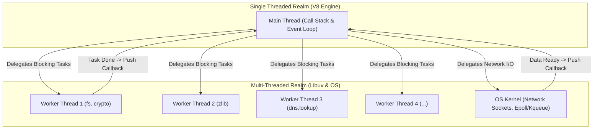
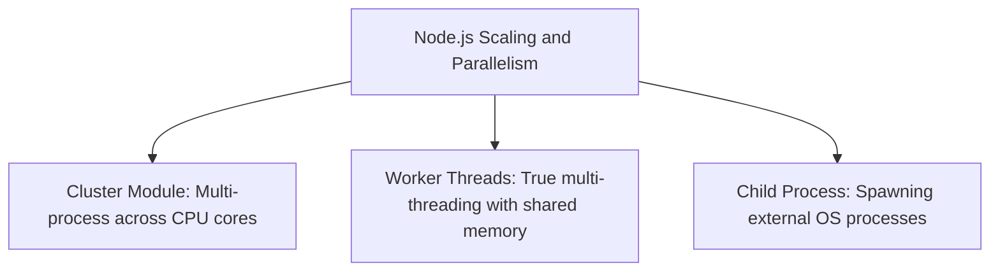

# ৪. Single-Threaded Node.js vs Multithreaded Servers (সিঙ্গেল থ্রেড বনাম মাল্টি-থ্রেডেড আর্কিটেকচার)

"Node.js কি আসলেই সিঙ্গেল থ্রেডেড?" — এটি সফটওয়্যার ইঞ্জিনিয়ারিং ইন্টারভিউতে সবচেয়ে জনপ্রিয় এবং ট্রিকি প্রশ্নগুলোর একটি। এই অধ্যায়ে আমরা এই প্রশ্নের পেছনের ভেতরের ইঞ্জিনিয়ারিং রহস্য উন্মোচন করব।

---

## ১. ইন্টারভিউ মিথ: Node.js কি শতভাগ সিঙ্গেল-থ্রেডেড?

> **ইন্টারভিউ প্রশ্ন:** "Node.js কি পুরোপুরি সিঙ্গেল থ্রেডেড?"
>
> **সঠিক উত্তর:** **না! জাভাস্ক্রিপ্ট কোড এক্সিকিউশন সিঙ্গেল থ্রেডেড, কিন্তু Node.js রানটাইম নিজে ব্যাকগ্রাউন্ডে মাল্টি-থ্রেডেড।**

Node.js-এ:
1. আপনার লেখা **JavaScript কোড (V8 Engine)** সবসময় একটি মাত্র থ্রেডে (Main Thread) রান করে।
2. কিন্তু ফাইল সিস্টেম (`fs`), ক্রিপ্টোগ্রাফি (`crypto`), কম্প্রেশন (`zlib`) এবং কিছু নেটওয়ার্কিং কাজের জন্য Node.js ব্যাকগ্রাউন্ডে **Libuv Thread Pool** (ডিফল্ট ৪টি থ্রেড) ব্যবহার করে।
3. এছাড়া অপারেটিং সিস্টেম কার্নেল লেভেলে নেটওয়ার্ক রিকোয়েস্টের জন্য সম্পূর্ণ অ্যাসিঙ্ক্রোনাস নন-ব্লকিং মেকানিজম কাজ করে।



---

## ২. মাল্টি-থ্রেডেড সার্ভার (Java/Tomcat/Apache) বনাম Node.js

### ক. মাল্টি-থ্রেডেড সার্ভারের মেকানিজম (Thread-per-request)
- প্রতিটি নতুন ইউজার বা রিকোয়েস্টের জন্য ওএস লেভেলে একটি ডেডিকেটেড থ্রেড বরাদ্দ করা হয়।
- থ্রেডের নিজস্ব স্ট্যাক মেমোরি থাকে (১ থেকে ২ মেগাবাইট)।
- **কনটেক্সট সুইচিং (Context Switching) সমস্যা:** যখন শত শত থ্রেড একই সাথে সিপিইউতে চলতে চেষ্টা করে, তখন অপারেটিং সিস্টেমকে এক থ্রেড থামিয়ে অন্য থ্রেডে যেতে হয়। এই ট্রানজিশনের সময় সিপিইউ প্রচুর সময় নষ্ট করে।
- **থ্রেড সেফটি ও ডেডলক:** মাল্টিপল থ্রেড একই শেয়ার্ড মেমোরি এক্সেস করতে গেলে রেস কন্ডিশন (Race Condition) তৈরি হয়, যা ঠেকাতে Lock/Mutex ব্যবহার করতে হয়। এতে প্রায়ই ডেডলক (Deadlock) তৈরি হয়।

### খ. Node.js মেকানিজম (Single Threaded Event Loop)
- একটি মাত্র মেইন থ্রেড সব রিকোয়েস্ট গ্রহণ করে।
- কোনো মেমোরি লকিং বা ডেডলকের ভয় নেই, কারণ শেয়ার্ড ভেরিয়েবল এক সময়ে একটাই থ্রেড এক্সেস করছে।
- মেমোরি খরচ অত্যন্ত কম (হাজার হাজার কানেকশনের জন্য মাত্র কয়েক মেগাবাইট)।

### তুলনামূলক ছক:

| বিষয় | মাল্টি-থ্রেডেড সার্ভার (Java/Apache) | Node.js (Event-Driven) |
| :--- | :--- | :--- |
| **কনকারেন্সি মডেল** | Thread-per-request | Event Loop + Non-blocking I/O |
| **মেমোরি খরচ** | প্রতি থ্রেডে ~১-২ MB (১০ হাজার রিকোয়েস্টে ~২০ GB) | পুরো সার্ভার মাত্র ৫০-১০০ MB মেমোরিতে চলে |
| **কনটেক্সট সুইচিং** | প্রচুর ওভারহেড থাকে | মেইন থ্রেডে কোনো কনটেক্সট সুইচিং নেই |
| **Concurrency Bugs** | Deadlock, Race Condition, Thread safety জটিলতা | জাভাস্ক্রিপ্ট লেভেলে ডেডলকের কোনো সুযোগ নেই |
| **I/O পারফরম্যান্স** | ভালো, তবে স্কেলিং করতে প্রচুর মেমোরি দরকার | অতুলনীয় দ্রুত ও অত্যন্ত স্কেলেবল |
| **ভারী গাণিতিক কাজ (CPU)** | চমৎকার (মাল্টিপল কোর সহজে ব্যবহার করা যায়) | দুর্বল (মেইন থ্রেড ব্লক হয়ে যেতে পারে) |

---

## ৩. Libuv Thread Pool ও `UV_THREADPOOL_SIZE`

Libuv লাইব্রেরিতে ব্যাকগ্রাউন্ডে একটি থ্রেড পুল থাকে যার ডিফল্ট সাইজ **৪**।

### কোন কাজগুলো Libuv Thread Pool ব্যবহার করে?
1. **File System (`fs`):** অপারেটিং সিস্টেম সাধারণত ফাইল অপারেশনের জন্য সম্পূর্ণ নন-ব্লকিং এপিআই দেয় না। তাই `fs.readFile`, `fs.writeFile` ব্যাকগ্রাউন্ড থ্রেড পুলে রান হয়।
2. **Crypto Functions:** `crypto.pbkdf2()`, `crypto.scrypt()`, `crypto.randomBytes()` ইত্যাদি ভারী গাণিতিক হ্যাশিং।
3. **Zlib (Compression):** `zlib.gzip()`, `zlib.deflate()` ইত্যাদি ডাটা কম্প্রেস করা।
4. **DNS Lookup:** `dns.lookup()` (অপারেটিং সিস্টেমের `getaddrinfo` কল সিঙ্ক্রোনাস হওয়ায় এটি থ্রেড পুলে চলে)।

### কোন কাজগুলো Thread Pool ব্যবহার করে না?
- **Network Sockets (HTTP, HTTPS, TCP, UDP):** এগুলো থ্রেড পুলে যায় না! লিনাক্সে `epoll`, ম্যাকওএসে `kqueue`, উইন্ডোজে `IOCP` সরাসরি অপারেটিং সিস্টেম কার্নেল লেভেলে সম্পূর্ণ নন-ব্লকিং ভাবে কোটি কোটি নেটওয়ার্ক প্যাকেট হ্যান্ডেল করে।

### থ্রেড পুল সাইজ বাড়ানোর উপায়:
প্রয়োজন অনুযায়ী অ্যাপ্লিকেশনের শুরুতে পরিবেশ ভেরিয়েবল সেট করে থ্রেড সংখ্যা বাড়ানো যায় (সর্বোচ্চ ১০২৪ পর্যন্ত):
```bash
# টার্মিনালে চালানোর সময়
UV_THREADPOOL_SIZE=8 node server.js
```
বা কোডের শুরুতে (যেকোনো অ্যাসিঙ্ক মডিউল লোড হওয়ার পূর্বে):
```javascript
process.env.UV_THREADPOOL_SIZE = "8";
```

---

## ৪. Node.js-এ CPU-Bound কাজ কীভাবে হ্যান্ডেল করবেন?

যদি আপনার অ্যাপ্লিকেশনে কোনো ভারী কাজ থাকে (যেমন: ভিডিও প্রসেসিং বা বড় ফাইল পার্সিং), তবে মেইন থ্রেড বাঁচানোর জন্য Node.js-এ ৩টি পদ্ধতি রয়েছে:



### ১) `worker_threads` (True Multi-Threading in Node.js)
Node.js v10.5+ থেকে নেটিভ থ্রেডিং সাপোর্ট রয়েছে। এটি দিয়ে ব্যাকগ্রাউন্ডে নতুন থ্রেড খুলে ভারী কাজ করানো যায়।

```typescript
// main.ts
import { Worker } from "node:worker_threads";

function runService(workerData: any) {
  return new Promise((resolve, reject) => {
    const worker = new Worker("./worker.js", { workerData });
    worker.on("message", resolve);
    worker.on("error", reject);
    worker.on("exit", (code) => {
      if (code !== 0) reject(new Error(`Worker stopped with exit code ${code}`));
    });
  });
}

async function run() {
  console.log("Main thread is free to handle other requests...");
  const result = await runService({ number: 40 });
  console.log("Fibonacci result from worker thread:", result);
}

run();
```

### ২) `cluster` মডিউল (Multi-Process Architecture)
যেহেতু একটি Node.js প্রসেস একটি মাত্র সিপিইউ কোর ব্যবহার করে, তাই সার্ভারে যদি ৮টি কোর থাকে তবে বাকি ৭টি কোর অলস বসে থাকে। `cluster` মডিউল বা **PM2** ব্যবহার করে প্রতিটি কোরের জন্য একটি করে প্রসেস (Worker Process) চালু করা যায়, যা একই পোর্ট শেয়ার করে ট্রাফিক ডিস্ট্রিবিউট করে।

---

## ৫. ইন্টারভিউ প্রশ্নোত্তর (Interview Q&A)

### প্রশ্ন ১: যদি Node.js মেইন থ্রেডে একটি `while(true)` লুপ চালানো হয়, তবে কী ঘটবে?
**উত্তর:** সার্ভার সম্পূর্ণ ফ্রিজ হয়ে যাবে! মেইন থ্রেড ওই লুপে আটকে যাবে, যার ফলে ইভেন্ট লুপ বন্ধ থাকবে। নতুন কোনো HTTP রিকোয়েস্ট ঢুকতে পারবে না, টাইমার এক্সিকিউট হবে না এবং চলমান রিকোয়েস্টগুলো টাইমআউট হয়ে ড্রপ করবে। একে বলা হয় **"Blocking the Event Loop"**।

### প্রশ্ন ২: Node.js-এ থ্রেড পুলে ডিফল্ট কয়টি থ্রেড থাকে এবং এর সর্বোচ্চ সীমা কত?
**উত্তর:** ডিফল্টভাবে Libuv থ্রেড পুলে **৪টি** থ্রেড থাকে। `UV_THREADPOOL_SIZE` ভেরিয়েবল সেট করে এটি সর্বোচ্চ **১০২৪** পর্যন্ত বাড়ানো যায়।

### প্রশ্ন ৩: `cluster` মডিউল এবং `worker_threads`-এর মূল পার্থক্য কী?
**উত্তর:**
- **`cluster`:** এটি সম্পূর্ণ পৃথক অপারেটিং সিস্টেম প্রসেস তৈরি করে (Fork করে)। প্রতিটি প্রসেসের আলাদা মেমোরি স্পেস এবং আলাদা V8 ইনস্ট্যান্স থাকে।
- **`worker_threads`:** এটি একই প্রসেসের অধীনে একাধিক লাইটওয়েট থ্রেড তৈরি করে। তারা একই প্রসেস মেমোরি ব্যবহার করে এবং `SharedArrayBuffer`-এর মাধ্যমে অত্যন্ত দ্রুত মেমোরি শেয়ার করতে পারে।
