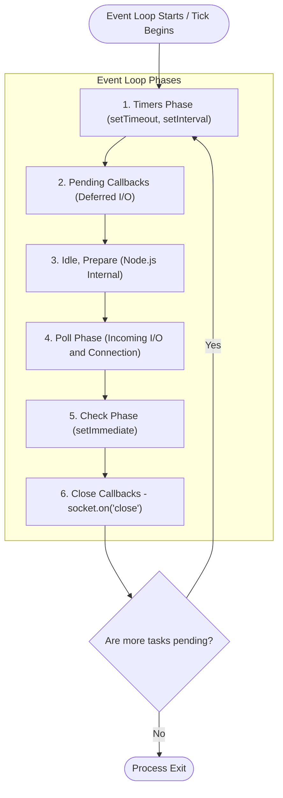
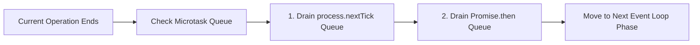

# ৫. How Event Loop Works (ইভেন্ট লুপের পুঙ্খানুপুঙ্খ ব্যবচ্ছেদ)

Node.js ইন্টারভিউতে যদি একটি বিষয় থাকে যা দিয়ে জুনিয়র ও সিনিয়ার ডেভেলপারদের পার্থক্য নির্ধারণ করা হয়, তবে সেটি হলো **ইভেন্ট লুপ (Event Loop)**। এই গাইডে আমরা ইভেন্ট লুপের প্রতিটা ফেজ, মাইক্রোটাস্কের অগ্রাধিকার এবং জটিল আউটপুট পাজল বিশ্লেষণ করব।

---

## ১. ইভেন্ট লুপ কী এবং কেন এটি প্রয়োজন?

ইভেন্ট লুপ হলো একটি অবিরাম চলমান ইনফিনিট লুপ (Infinite Loop), যা Libuv লাইব্রেরি দ্বারা পরিচালিত হয়।
এর কাজ হলো:
- **Call Stack** খালি আছে কিনা চেক করা।
- বিভিন্ন অ্যাসিঙ্ক্রোনাস কিউ (Queue) থেকে কলব্যাক এনে Call Stack-এ এক্সিকিউটের জন্য পুশ করা।
- অপারেটিং সিস্টেম কার্নেল বা থ্রেড পুল থেকে কোনো I/O রেজাল্ট প্রস্তুত হয়েছে কিনা তা নজরদারি করা।

---

## ২. ইভেন্ট লুপের ৬টি প্রধান ফেজ (The 6 Phases of Libuv)

ইভেন্ট লুপের প্রতিটি পূর্ণ আবর্তনকে একটি **Tick** বলা হয়। প্রতিটি টিকে ইভেন্ট লুপ নির্দিষ্ট ৬টি ফেজ ক্রমানুসারে অতিক্রম করে:



### প্রতিটি ফেজের বিস্তারিত দায়িত্ব:

#### ১) Timers Phase:
- এখানে `setTimeout()` এবং `setInterval()`-এর নির্ধারিত সময় অতিক্রান্ত হওয়া (expired) কলব্যাকগুলো এক্সিকিউট হয়।
- মনে রাখবেন: টাইমার কোনো নির্দিষ্ট সময়ে এক্সিকিউট হওয়ার **গ্যারান্টি দেয় না**, এটি দেয় **নূন্যতম বিলম্বের গ্যারান্টি** (Minimum Threshold)।

#### ২) Pending Callbacks (I/O Callbacks) Phase:
- অপারেটিং সিস্টেমের কিছু বিলম্বিত I/O কলব্যাক এখানে এক্সিকিউট হয়। যেমন: টিসিপি এরর (যেমন `ECONNREFUSED`) রিপোর্ট করা।

#### ৩) Idle, Prepare Phase:
- এটি সম্পূর্ণ Node.js-এর নিজস্ব অভ্যন্তরীণ কাজের জন্য সংরক্ষিত। ডেভেলপারদের এতে সরাসরি কোনো নিয়ন্ত্রণ নেই।

#### ৪) Poll Phase (সবচেয়ে গুরুত্বপূর্ণ ফেজ):
- **দুটি প্রধান দায়িত্ব:**
  1. I/O কিউতে থাকা কলব্যাকগুলো (যেমন: ডাটাবেস রেসপন্স, ফাইল রিড, নতুন HTTP রিকোয়েস্ট) প্রসেস করা।
  2. কতক্ষণ অপেক্ষা (Block) করতে হবে তা হিসাব করা।
- যদি পোল কিউ খালি থাকে:
  - যদি কোনো `setImmediate()` শিডিউল করা থাকে, তবে ইভেন্ট লুপ পোল ফেজ শেষ করে সরাসরি **Check Phase**-এ চলে যায়।
  - যদি কোনো `setImmediate()` না থাকে, তবে ইভেন্ট লুপ পোল ফেজে নতুন I/O ইভেন্টের জন্য অপেক্ষা করে। তবে যদি কোনো টাইমারের সময় পার হয়ে যায়, তবে লুপ ঘুরে আবার Timers ফেজে চলে যায়।

#### ৫) Check Phase:
- এটি বিশেষভাবে **`setImmediate()`** কলব্যাকগুলো রান করার জন্য তৈরি।
- পোল ফেজ শেষ হওয়ার ঠিক পরপরই চেক ফেজ রান হয়।

#### ৬) Close Callbacks Phase:
- কানেকশন বা সকেট হঠাৎ বন্ধ হলে যে ক্লোজ হ্যান্ডলারগুলো থাকে, সেগুলো এখানে রান হয়।
- উদাহরণ: `socket.on('close', ...)`, `server.close(...)`।

---

## ৩. সিক্রেট বস: Microtask Queue (`nextTick` vs `Promise`)

ইভেন্ট লুপের ৬টি ফেজের বাইরে আরও দুটি স্পেশাল কিউ রয়েছে, যাদের বলা হয় **Microtask Queue**।
ইভেন্ট লুপের যেকোনো ফেজের একটি মাত্র কাজ শেষ হওয়ার সাথে সাথে—এমনকি পরবর্তী ফেজে যাওয়ার আগে—Node.js সর্বদা মাইক্রোটাস্ক কিউ খালি করে ফেলে!

মাইক্রোটাস্কের অগ্রাধিকার তালিকা:

> **অগ্রাধিকার ক্রম:**
> `process.nextTick Queue` ➔ `Promise Microtask Queue (then, catch, queueMicrotask)` ➔ `Event Loop Phases`



### ১) `process.nextTick()`:
- এটি প্রযুক্তিগতভাবে ইভেন্ট লুপের অংশই নয়।
- এটি কল স্ট্যাক খালি হওয়ার সাথে সাথে বর্তমান ফেজের মাঝেই অগ্রাধিকার ভিত্তিতে সবার আগে এক্সিকিউট হয়।
- **সতর্কতা:** `process.nextTick()`-এর ভেতর রিকার্সিভ কল দিলে ইভেন্ট লুপ স্টারভেশনে পড়বে এবং পুরো সার্ভার হ্যাং হবে (I/O Starvation)।

### ২) `Promise.then()` / `async await`:
- এটি `process.nextTick()` এর ঠিক পরেই অবস্থান করে।

---

## ৪. বহুল আলোচিত ইন্টারভিউ দ্বন্দ্ব: `setTimeout(fn, 0)` বনাম `setImmediate(fn)`

> **ইন্টারভিউ প্রশ্ন:** "যদি মেইন স্ক্রিপ্টে `setTimeout(fn, 0)` এবং `setImmediate(fn)` পাশাপাশি লেখা হয়, কোনটি আগে চলবে?"

```javascript
setTimeout(() => {
  console.log("setTimeout");
}, 0);

setImmediate(() => {
  console.log("setImmediate");
});
```

### চমকপ্রদ উত্তর: এর আউটপুট অনির্ধারিত (Non-deterministic)!
কখনো `setTimeout` আগে আসবে, কখনো `setImmediate` আগে আসবে।
**কারণ:** 
Node.js-এ `setTimeout(fn, 0)` লিখলেও এর অভ্যন্তরীণ মান হয় `1ms` (Node.js ০ মিলিসেকেন্ডকে ১ মিলিসেকেন্ড হিসেবে কনভার্ট করে)।
লুপ যখন শুরু হয়, তখন সিপিইউ টাইমার রেজিস্টার করতে যদি ১ মিলিসেকেন্ডের কম সময় নেয়, তবে টাইমার এখনো এক্সপায়ার হয়নি বলে ইভেন্ট লুপ Timers ফেজ পার হয়ে Poll হয়ে Check ফেজে চলে যায় এবং `setImmediate` আগে রান করে। আর যদি সিস্টেমের ১ মিলিসেকেন্ড পার হয়ে যায়, তবে `setTimeout` আগে রান করে।

### কিন্তু যখন এটি কোনো I/O সাইকেলের ভেতরে থাকে:
```javascript
import fs from "node:fs";

fs.readFile(__filename, () => {
  setTimeout(() => console.log("timeout"), 0);
  setImmediate(() => console.log("immediate"));
});
```
**আউটপুট সর্বদা ১০০% নিশ্চিতভাবে:**
```text
immediate
timeout
```
**কারণ:** `readFile`-এর কলব্যাকটি চলে **Poll Phase**-এ। পোল ফেজ শেষ হওয়ার ঠিক পরবর্তী ফেজটিই হলো **Check Phase** (`setImmediate`)। তাই `setImmediate` সর্বদা টাইমার ফেজের আগে রান করবে। এটি ইন্টারভিউতে সিনিয়ার লেভেলের একটি প্রিয় প্রশ্ন!

---

## ৫. মাস্টার ইন্টারভিউ পাজল ও লাইন-বাই-লাইন ট্রেসিং

নিচের কোডটির আউটপুট কী হবে এবং কেন?

```javascript
console.log("1. Sync Main Start");

setTimeout(() => {
  console.log("2. setTimeout 0");
  process.nextTick(() => {
    console.log("3. nextTick inside setTimeout");
  });
}, 0);

setImmediate(() => {
  console.log("4. setImmediate");
});

process.nextTick(() => {
  console.log("5. nextTick 1");
  Promise.resolve().then(() => {
    console.log("6. Promise inside nextTick");
  });
});

Promise.resolve().then(() => {
  console.log("7. Promise 1");
  process.nextTick(() => {
    console.log("8. nextTick inside Promise");
  });
});

console.log("9. Sync Main End");
```

### এক্সিকিউশন স্টেপ বিশ্লেষণ:

1. **সিঙ্ক্রোনাস কোড সবার আগে চলবে:**
   - প্রিন্ট হবে: `1. Sync Main Start`
   - `setTimeout` চলে যাবে Timers ফেজের জন্য।
   - `setImmediate` চলে যাবে Check ফেজের জন্য।
   - `process.nextTick` চলে যাবে `nextTickQueue`-তে।
   - `Promise.then` চলে যাবে `microtaskQueue`-তে।
   - প্রিন্ট হবে: `9. Sync Main End`
2. **কল স্ট্যাক খালি হলো, মাইক্রোটাস্ক ড্রেন হবে:**
   - প্রথমে `nextTickQueue` খালি হবে: প্রিন্ট হবে `5. nextTick 1` এবং এর ভেতরের `Promise` মাইক্রোটাস্ক কিউতে যুক্ত হবে।
   - এবার মাইক্রোটাস্ক কিউ থেকে প্রিন্ট হবে `7. Promise 1`।
   - এর ভেতরের `nextTick` আবার `nextTickQueue`-তে গেল এবং সাথে সাথে এক্সিকিউট হয়ে প্রিন্ট করবে: `8. nextTick inside Promise`।
   - এরপর আগের পেন্ডিং প্রমিজ প্রিন্ট করবে: `6. Promise inside nextTick`।
3. **ইভেন্ট লুপ ফেজ ১: Timers Phase:**
   - প্রিন্ট হবে `2. setTimeout 0`।
   - এর ভেতরের `process.nextTick` ফেজ শেষ হওয়ার সাথে সাথে ড্রেন হবে এবং প্রিন্ট করবে: `3. nextTick inside setTimeout`।
4. **ইভেন্ট লুপ ফেজ ৫: Check Phase:**
   - প্রিন্ট হবে `4. setImmediate`।

### চূড়ান্ত আউটপুট:
```text
1. Sync Main Start
9. Sync Main End
5. nextTick 1
7. Promise 1
8. nextTick inside Promise
6. Promise inside nextTick
2. setTimeout 0
3. nextTick inside setTimeout
4. setImmediate
```

---

## ৬. ইন্টারভিউ প্রশ্নোত্তর (Interview Q&A)

### প্রশ্ন ১: `process.nextTick()` এবং `setImmediate()`-এর নামকরণের বিভ্রান্তি কী?
**উত্তর:** রায়ান ডাল নিজেই পরবর্তীতে স্বীকার করেছিলেন যে এই দুটি মেথডের নাম অদলবদল হওয়া উচিত ছিল।
- `process.nextTick()` নাম শুনে মনে হয় পরবর্তী টিকে চলবে, কিন্তু এটি চলে **বর্তমান টিকের সবার আগে**।
- `setImmediate()` নাম শুনে মনে হয় অবিলম্বে চলবে, কিন্তু এটি চলে **ইভেন্ট লুপের পরবর্তী চক্করে চেক ফেজে**।

### প্রশ্ন ২: Event Loop ব্লকিং কীভাবে এড়ানো যায়?
**উত্তর:**
1. ভারী `JSON.parse()` বা রেগুলার এক্সপ্রেশন (ReDoS) মেইন থ্রেডে না চালানো।
2. ভারী হিসাব-নিকাশের জন্য `worker_threads` ব্যবহার করা।
3. সিঙ্ক্রোনাস মেথড (যেমন `fs.readFileSync`, `crypto.pbkdf2Sync`) প্রোডাকশন সার্ভারের রিকোয়েস্ট হ্যান্ডলারে ব্যবহার না করা।
