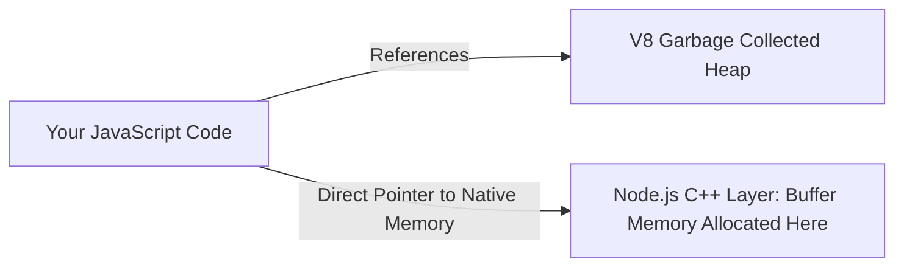
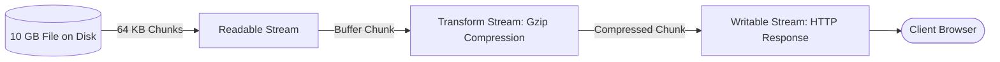

# ৬. Streams, Buffers & Modular Systems Deep Dive (স্ট্রিম, বাফার ও মডিউল সিস্টেম)

Node.js-এ মেমোরি বাঁচিয়ে গিগাবাইট সাইজের বিগ ডাটা প্রসেসিং এবং কোড অর্গানাইজেশনের মূল চাবিকাঠি হলো **Streams, Buffers** এবং **Module Systems**। এই আর্টিকেলে তিনটি বিষয়ের গভীরে প্রবেশ করব।

---

## ১. Buffers: বাইনারি ডাটা হ্যান্ডলিংয়ের পেছনের বিজ্ঞান

জাভাস্ক্রিপ্ট যখন ব্রাউজারে তৈরি হয়েছিল, তখন এটি ডিজাইন করা হয়েছিল শুধুমাত্র স্ট্রিং এবং সংখ্যা নিয়ে খেলার জন্য। ব্রাউজারের বাইনারি ডাটা নিয়ে সরাসরি কাজ করার প্রয়োজন ছিল না।

কিন্তু সার্ভার সাইডে Node.js-কে প্রতিনিয়ত TCP প্যাকেট, ইমেজ ফাইল, ভিডিও স্ট্রিম এবং ডাটাবেস প্রোটোকলের **Raw Binary Data** নিয়ে কাজ করতে হয়। এজন্য Node.js-এ তৈরি করা হয়েছে **Buffer** ক্লাস।



### বাফারের মূল বৈশিষ্ট্য:
1. **বাইরের মেমোরি:** বাফারের মেমোরি V8 হিপের বাইরে সরাসরি অপারেটিং সিস্টেমের র‍্যামে (C++ মেমোরি) বরাদ্দ করা হয়।
2. **স্থির সাইজ:** একবার বাফার তৈরি হয়ে গেলে এর আকার বাড়ানো বা কমানো যায় না (Fixed Size)।
3. এটি মূলত কাঁচা মেমোরির একটি অ্যারে, যেখানে প্রতিটি সেল ৮-বিট (১ বাইট = ০ থেকে ২৫৫ এর মান) ডাটা সংরক্ষণ করে (Hexadecimal আকারে দৃশ্যমান)।

### `Buffer.alloc()` বনাম `Buffer.allocUnsafe()` (গুরুত্বপূর্ণ ইন্টারভিউ প্রশ্ন)
```typescript
import { Buffer } from "node:buffer";

// ১. নিরাপদ পদ্ধতি (শূন্য দিয়ে মেমোরি পরিষ্কার করে দেয়)
const safeBuf = Buffer.alloc(10);
console.log(safeBuf); // <Buffer 00 00 00 00 00 00 00 00 00 00>

// ২. অনিরাপদ ও সুপার ফাস্ট পদ্ধতি
const unsafeBuf = Buffer.allocUnsafe(10);
console.log(unsafeBuf); // <Buffer 4a 72 00 1f ...> (পুরোনো মেমোরির ময়লা ডাটা)
```

> **ইন্টারভিউ প্রশ্ন:** "কেন `Buffer.allocUnsafe()` বিপজ্জনক?"
>
> **উত্তর:** `allocUnsafe` মেমোরি খালি করার জন্য সময় নষ্ট করে না, অপারেটিং সিস্টেমের পূর্ববর্তী অব্যবহৃত মেমোরি সরাসরি দিয়ে দেয়। ফলে ওই মেমোরিতে যদি পূর্ববর্তী কোনো ইউজারের পাসওয়ার্ড, ক্রেডিট কার্ড নম্বর বা প্রাইভেট কি (Private Key) থেকে থাকে, তবে তা ডাটা লিক (Security Vulnerability) ঘটাতে পারে!

---

## ২. Streams: মেমোরি ফ্রেন্ডলি ডাটা প্রসেসিং

ধরা যাক, আপনার সার্ভারে ১০ জিবি সাইজের একটি ভিডিও ফাইল আছে।
যদি আপনি `fs.readFile()` ব্যবহার করেন, তবে Node.js পুরো ১০ জিবি ফাইল একবারে সার্ভারের র‍্যামে লোড করতে যাবে এবং মেমোরি ক্র্যাশ করবে।

**স্ট্রিম (Stream)-এর জাদু:**
স্ট্রিম পুরো ফাইল একসাথে না নিয়ে ছোট ছোট খণ্ডে (Chunks, সাধারণত 64 KB) ডাটা ভাগ করে এক প্রান্ত থেকে অন্য প্রান্তে প্রবাহিত করে।



### স্ট্রিমের ৪টি ধরন:
1. **Readable Stream:** যেখান থেকে ডাটা পড়া যায় (যেমন: `fs.createReadStream`, `process.stdin`, `http.IncomingMessage`)।
2. **Writable Stream:** যেখানে ডাটা রাইট করা যায় (যেমন: `fs.createWriteStream`, `process.stdout`, `http.ServerResponse`)।
3. **Duplex Stream:** যা একই সাথে রিড এবং রাইট উভয়ই করতে পারে (যেমন: `net.Socket` টিসিপি কানেকশন)।
4. **Transform Stream:** এক ধরনের ডুপ্লেক্স স্ট্রিম, যা ডাটা ইনপুট নিয়ে পরিবর্তন করে আউটপুট দেয় (যেমন: `zlib.createGzip()` কম্প্রেশন, `crypto.createCipheriv()` এনক্রিপশন)।

---

## ৩. The Backpressure Problem (ব্যাকপ্রেশার সমস্যা)

> **ইন্টারভিউ প্রশ্ন:** "স্ট্রিম ব্যাকপ্রেশার (Backpressure) কী এবং কেন এটি ঘটে?"

### সমস্যা:
ধরা যাক, আপনার হার্ডডিস্ক থেকে প্রতি সেকেন্ডে ১০০ মেগাবাইট ডাটা পড়া হচ্ছে (Readable Stream), কিন্তু ক্লায়েন্টের স্লো ইন্টারনেটের কারণে সার্ভার ক্লায়েন্টকে প্রতি সেকেন্ডে মাত্র ১ মেগাবাইট ডাটা পাঠাতে পারছে (Writable Stream)।
এই বাড়তি ৯৯ মেগাবাইট ডাটা কোথায় যাবে? এটি স্বয়ংক্রিয়ভাবে সার্ভারের র‍্যামের অভ্যন্তরীণ বাফারে জমা হতে থাকবে। কিছুক্ষণের মধ্যে র‍্যাম ভর্তি হয়ে যাবে এবং অ্যাপ ক্র্যাশ করবে! একেই বলে **Backpressure**।

### ব্যাকপ্রেশার সমাধানের আদর্শ উপায়: `pipeline()`
পূর্বে ডেভেলপাররা `readable.pipe(writable)` ব্যবহার করত, যাতে এরর হ্যান্ডলিং ও মেমোরি লিক হতো। আধুনিক Node.js-এ স্ট্যান্ডার্ড সলিউশন হলো **`stream/promises` এর `pipeline`**:

```typescript
import fs from "node:fs";
import zlib from "node:zlib";
import { pipeline } from "node:stream/promises";

async function compressFile(source: string, destination: string) {
  try {
    await pipeline(
      fs.createReadStream(source), // ১. ফাইল রিড স্ট্রিম
      zlib.createGzip(),           // ২. ট্র্যান্সফর্ম স্ট্রিম (কম্প্রেস)
      fs.createWriteStream(destination) // ৩. ফাইল রাইট স্ট্রিম
    );
    console.log("File compression completed safely without backpressure issues!");
  } catch (err) {
    console.error("Pipeline failed:", err);
  }
}

compressFile("huge_log.txt", "huge_log.txt.gz");
```
`pipeline` স্বয়ংক্রিয়ভাবে রাইটার যখন পূর্ণ হয়ে যায় তখন রিডারকে থামিয়ে দেয় (`pause`), আবার রাইটার ডাটা ডেলিভারি শেষ করলে রিডারকে রিজিউম করে (`resume`)।

---

## ৪. Modular Systems: CommonJS (CJS) বনাম ECMAScript Modules (ESM)

Node.js-এ দুটি প্রধান মডিউল সিস্টেম বিদ্যমান:

| ফিচার | CommonJS (CJS) | ECMAScript Modules (ESM) |
| :--- | :--- | :--- |
| **সিনট্যাক্স** | `const fs = require('fs')`, `module.exports` | `import fs from 'fs'`, `export default` |
| **লোডিং প্রকৃতি** | **Synchronous & Runtime** (রানটাইমে কোড লোড হয়) | **Asynchronous & Static / Parse-time** |
| **ফাইলের এক্সটেনশন** | `.js` (ডিফল্ট) বা `.cjs` | `.mjs` বা `package.json`-এ `"type": "module"` |
| **Top-level Await** | সাপোর্ট করে না (IIFE এর ভেতরে নেওয়া লাগত) | সাপোর্ট করে (`await fetch(...)` সরাসরি ফাইলে লেখা যায়) |
| **ট্রি-শেকিং (Tree Shaking)** | খুব কঠিন (কারণ রানটাইমে পরিবর্তনশীল) | অত্যন্ত সহজ (কম্পাইল টাইমে স্ট্যাটিক অ্যানালাইসিস সম্ভব) |
| **স্পেশাল ভেরিয়েবল** | `__filename`, `__dirname` সরাসরি থাকে | থাকে না (`import.meta.url` দিয়ে তৈরি করতে হয়) |

### Module Caching Mechanism (মডিউল ক্যাশিং)
Node.js-এ যখনই কোনো ফাইল `require()` করা হয়, তখন প্রথমবার ফাইলটি ডিস্ক থেকে পড়ে এক্সিকিউট করার পর এর এক্সপোর্টকৃত রেজাল্ট `require.cache`-এ মেমোরিতে সংরক্ষণ (Cache) করা হয়।
পরবর্তীতে অন্য কোনো ফাইল থেকে পুনরায় একই ফাইল `require()` করা হলে Node.js আর ডিস্ক থেকে ফাইলটি পড়ে না, সরাসরি মেমোরি ক্যাশ থেকে ফিরিয়ে দেয়।

```javascript
// foo.js
console.log("Foo evaluated!");
module.exports = { value: Math.random() };

// main.js
const a = require("./foo"); // কনসোলে প্রিন্ট হবে: "Foo evaluated!"
const b = require("./foo"); // কোনো প্রিন্ট হবে না, ক্যাশ থেকে আসবে

console.log(a === b); // true (একই অবজেক্ট রেফারেন্স)
```

---

## ৫. ইন্টারভিউ প্রশ্নোত্তর (Interview Q&A)

### প্রশ্ন ১: `Stream` এবং `Buffer`-এর মধ্যে মূল পার্থক্য কী?
**উত্তর:** বাফার হলো মেমোরিতে একবারে বরাদ্দ করা নির্দিষ্ট সাইজের কাঁচা বাইনারি ডাটা ব্লক। আর স্ট্রিম হলো একটি মেকানিজম বা ডাটা পাইপলাইন, যার মাধ্যমে বাফারের ছোট ছোট খণ্ড (Chunks) একটি সোর্স থেকে ডেস্টিনেশনে একটানা প্রবাহিত হতে পারে।

### প্রশ্ন ২: CommonJS-এ `require()` কেন সিঙ্ক্রোনাসলি কাজ করে?
**উত্তর:** ২০০৯ সালে যখন Node.js তৈরি হয়েছিল, তখন এটি ডিজাইন করা হয়েছিল লোকাল ফাইল সিস্টেম থেকে ফাইল পড়ার জন্য। লোকাল ডিস্ক থেকে জাভাস্ক্রিপ্ট ফাইল রিড করা কয়েক মাইক্রোসেকেন্ডের কাজ। তাই সহজে সিকুয়েনশিয়াল ডিপেনডেন্সি নিশ্চিত করার জন্য `require()`-কে সিঙ্ক্রোনাস রাখা হয়েছিল। ব্রাউজারের মতো নেটওয়ার্ক থেকে দূরবর্তী ফাইল লোড করার প্রয়োজন ছিল না।

### প্রশ্ন ৩: ESM-এ `__dirname` এবং `__filename` কীভাবে পেতে পারি?
**উত্তর:**
```javascript
import { fileURLToPath } from "node:url";
import { dirname } from "node:path";

const __filename = fileURLToPath(import.meta.url);
const __dirname = dirname(__filename);
```
