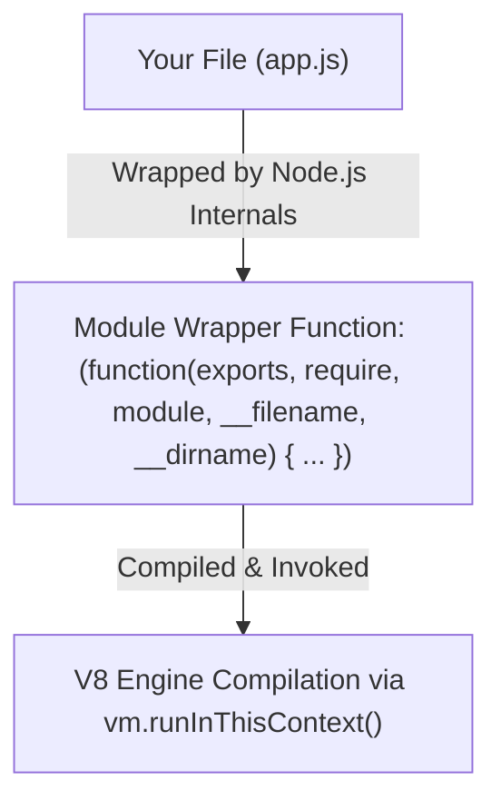
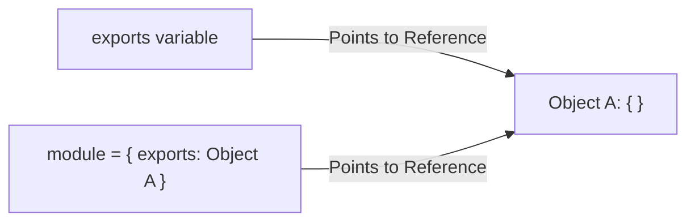
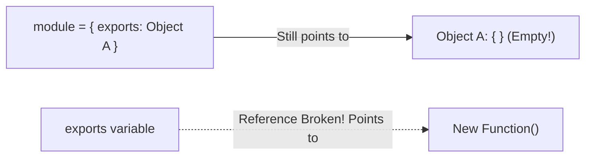

# ৭. Harnessing IIFE as the Ultimate Module Wrapper (মডিউল র‍্যাপার ও IIFE-র অভ্যন্তরীণ রহস্য)

"ব্রাউজারে একটি জাভাস্ক্রিপ্ট ফাইলে কোনো ভেরিয়েবল লিখলে তা গ্লোবাল হয়ে যায়, কিন্তু Node.js-এ একটি ফাইলে ভেরিয়েবল ডিক্লেয়ার করলে তা অন্য ফাইলে সরাসরি পাওয়া যায় না কেন?" — এই সহজ প্রশ্নের ভেতরে লুকিয়ে আছে Node.js-এর একটি অন্যতম সেরা আর্কিটেকচারাল সিক্রেট: **Module Wrapper Function**।

---

## ১. ব্রাউজারের সমস্যা বনাম Node.js-এর সমাধান

ব্রাউজারে লেগাসি স্ক্রিপ্ট ট্যাগে:
```html
<script src="file1.js"></script>
<script src="file2.js"></script>
```
`file1.js`-এ যদি `var user = "Rahim";` লেখা হয়, তবে তা স্বয়ংক্রিয়ভাবে `window.user` (গ্লোবাল স্কোপ)-এ চলে যেত। `file2.js`-এও একই নামের ভেরিয়েবল থাকলে তা ওভাররাইট হয়ে ভয়াবহ বাগ তৈরি করত। একে বলে **Global Scope Pollution**।

Node.js এই সমস্যার চিরতরে অবসান ঘটিয়েছে জাভাস্ক্রিপ্টের অন্যতম শক্তিশালী প্যাটার্ন **IIFE (Immediately Invoked Function Expression)** ব্যবহারের মাধ্যমে।

---

## ২. Node.js-এর ভেতরের দৃশ্য: The Secret Module Wrapper

আপনি যখনই কোনো CommonJS ফাইল তৈরি করেন (যেমন `app.js`):
```javascript
const secretApiKey = "SECRET_12345";

function calculateSalary(amount) {
  return amount * 1.2;
}

module.exports = calculateSalary;
```

Node.js এই ফাইলটি সরাসরি যেমন আছে তেমন রান করে না! ফাইলটি কম্পাইল এবং রান করার পূর্বে Node.js এর চারপাশে একটি গোপন **Function Wrapper** জড়িয়ে দেয়:

```javascript
(function (exports, require, module, __filename, __dirname) {
  // 👉 আপনার কোডটি আসলে এই ফাংশনের ভেতরে থাকে!
  const secretApiKey = "SECRET_12345";

  function calculateSalary(amount) {
    return amount * 1.2;
  }

  module.exports = calculateSalary;
});
```



### এই র‍্যাপারের কারণে কী কী সুবিধা পাওয়া যায়?
1. **Scope Isolation:** আপনার ফাইলের সমস্ত ভেরিয়েবল (`const`, `let`, `var`, `function`) ওই র‍্যাপার ফাংশনের লোকাল স্কোপে আবদ্ধ থাকে। ফলে কখনোই গ্লোবাল স্কোপ পলিউশন হয় না।
2. **Magic Variables Injection:** আপনি কখনো ভেবে দেখেছেন কি—`require`, `module`, `exports`, `__filename`, `__dirname` এগুলো আপনি ফাইলে ইমপোর্ট বা ডিফাইন না করেও কীভাবে ব্যবহার করতে পারেন?
   - কারণ Node.js র‍্যাপার ফাংশনের আর্গুমেন্ট হিসেবে এই ৫টি অবজেক্ট আপনার ফাইলে ইনজেক্ট করে দেয়!

---

## ৩. প্রমাণ: Node.js-এর ভেতরে র‍্যাপার ফাংশনটি স্বচক্ষে দেখা

আপনি নিজেই টার্মিনালে বা কোডে এই র‍্যাপার ফাংশনটি দেখতে পারেন:

```typescript
import { wrapper } from "node:module";

console.log(wrapper);
```
**টার্মিনাল আউটপুট:**
```javascript
[
  '(function (exports, require, module, __filename, __dirname) { ',
  '\n});'
]
```
Node.js আপনার ফাইলের স্ট্রিং কন্টেন্টকে ইনডেক্স `0` এবং `1`-এর মাঝখানে বসিয়ে `vm.runInThisContext()` দিয়ে রান করে!

---

## ৪. মাস্টার ইন্টারভিউ ট্র্যাপ: `exports` বনাম `module.exports`

সব ইন্টারভিউ বোর্ডে এই প্রশ্নটি জিজ্ঞেস করা হয়:
> **প্রশ্ন:** "`exports` এবং `module.exports`-এর মধ্যে সম্পর্ক কী? নিচের কোডটিতে কী আউটপুট আসবে?"

```javascript
// math.js
exports = function (a, b) {
  return a + b;
};

// app.js
const add = require("./math");
console.log(add(2, 3)); // 💥 TypeError: add is not a function!
```

### কেন এরর হলো? ভেতরের মেকানিজম বুঝুন:

র‍্যাপার ফাংশনটি কল করার সময় Node.js ব্যাকগ্রাউন্ডে একটি ফাঁকা অবজেক্ট তৈরি করে:
```javascript
const module = { exports: {} };
let exports = module.exports; // 👈 exports মূলত module.exports-এর একটি শর্টকাট রেফারেন্স মাত্র!
```



- যখন আপনি লিখছেন: `exports.add = fn;`, তখন `Object A`-এর ভেতরে প্রোপার্টি যুক্ত হচ্ছে। ফলে `module.exports`-ও তা পাচ্ছে।
- কিন্তু যখন আপনি লিখছেন: `exports = fn;`, তখন আপনি `exports` ভেরিয়েবলটির রেফারেন্স ছিঁড়ে দিয়ে নতুন একটি ফাংশনের সাথে যুক্ত করছেন!
- কিন্তু Node.js দিনশেষে ফাইল থেকে রিটার্ন করে কেবল **`module.exports`**-কে। `module.exports` তখনো আগের সেই ফাঁকা অবজেক্ট `{}` হয়েই রয়ে যায়!



### সমাধানের গোল্ডেন রুল:
1. যদি আপনি কোনো অবজেক্টের ভেতর প্রোপার্টি বা মেথড যোগ করতে চান, তবে `exports.myMethod = ...` অথবা `module.exports.myMethod = ...` উভয়ই কাজ করবে।
2. কিন্তু যদি আপনি সরাসরি একটি ফাংশন, ক্লাস বা অ্যারে এক্সপোর্ট করতে চান, তবে **সর্বদা `module.exports = ...`** ব্যবহার করতে হবে। কখনোই সরাসরি `exports = ...` লিখবেন না।

---

## ৫. ইন্টারভিউ প্রশ্নোত্তর (Interview Q&A)

### প্রশ্ন ১: Node.js-এ মডিউল র‍্যাপার ফাংশনের ৫টি প্যারামিটার কী কী?
**উত্তর:**
1. `exports`: `module.exports`-এর রেফারেন্স শর্টকাট।
2. `require`: মডিউল লোড করার জন্য হেল্পার ফাংশন।
3. `module`: বর্তমান মডিউলের রিপ্রেজেন্টেশন (যার মধ্যে `id`, `filename`, `loaded`, `exports` ইত্যাদি অবজেক্ট থাকে)।
4. `__filename`: বর্তমান ফাইলের পরম পাথ (Absolute file path)।
5. `__dirname`: বর্তমান ফাইলের ডিরেক্টরি পাথ (Absolute directory path)।

### প্রশ্ন ২: ECMAScript Modules (ESM)-এ কি এই Module Wrapper কাজ করে?
**উত্তর:** না। ESM-এ CommonJS-এর মতো এই ফাংশন র‍্যাপার কাজ করে না। ESM কাজ করে আধুনিক ব্রাউজার স্পেসিফিকেশন ও অ্যাবস্ট্রাক্ট মডিউল রেকর্ডের মাধ্যমে। ফলে ESM-এ `__filename`, `__dirname`, বা `module.exports` থাকে না। এর পরিবর্তে `import.meta.url` এবং `export` সিনট্যাক্স ব্যবহৃত হয়।

### প্রশ্ন ৩: `globalThis` বা `global` অবজেক্ট কী?
**উত্তর:** যদি কোনো কারণে ডেভেলপারকে সত্যিই এমন কোনো ভেরিয়েবল বানাতে হয় যা সমস্ত ফাইল থেকে কোনো `require` বা `import` ছাড়াই এক্সেস করা যাবে, তবে তাকে Node.js-এর `global` বা `globalThis` অবজেক্টে প্রোপার্টি হিসেবে সেট করতে হয় (যেমন `global.appName = "MyBackend"`), যদিও এটি খারাপ প্র্যাকটিস হিসেবে গণ্য করা হয়।
